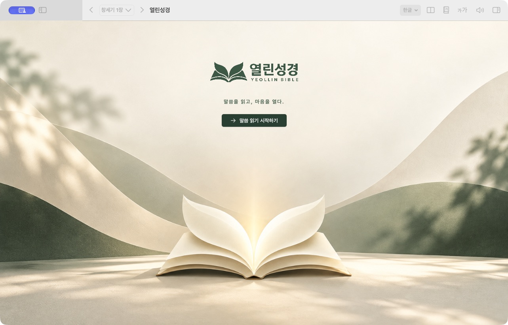
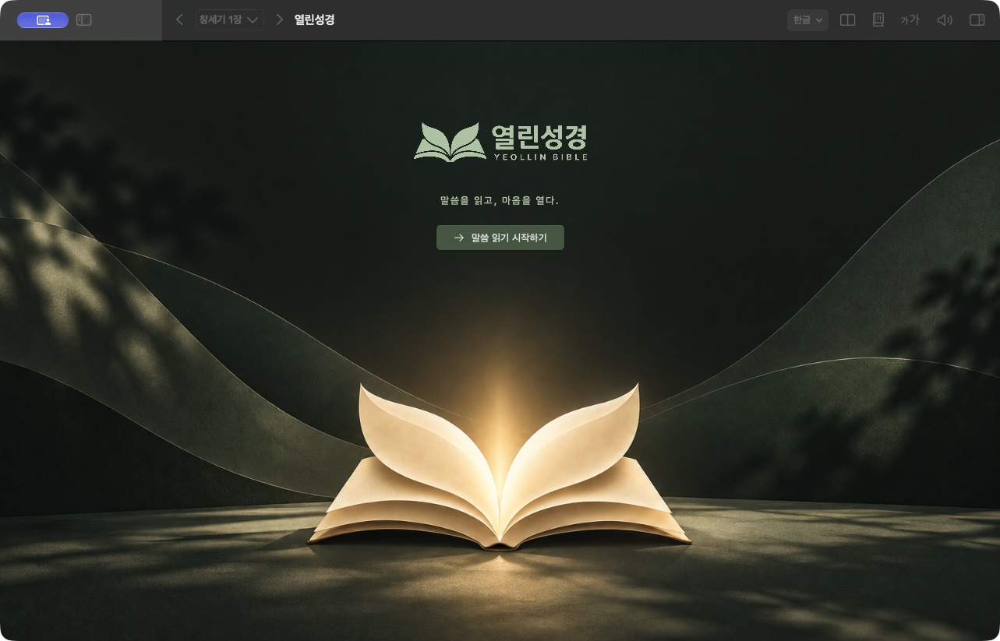
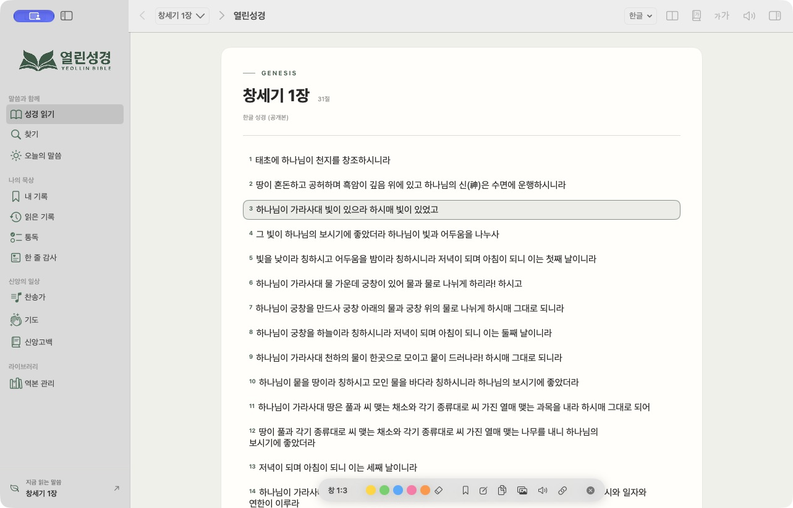
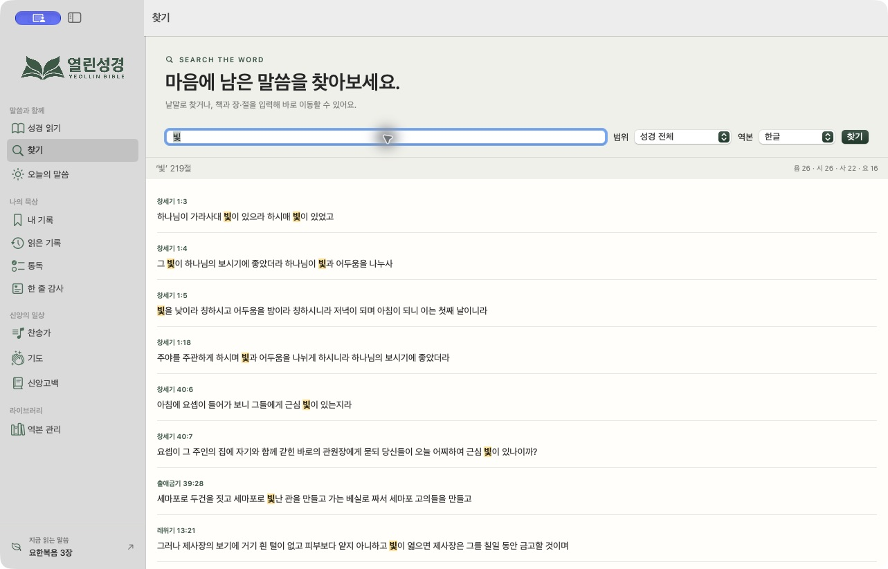
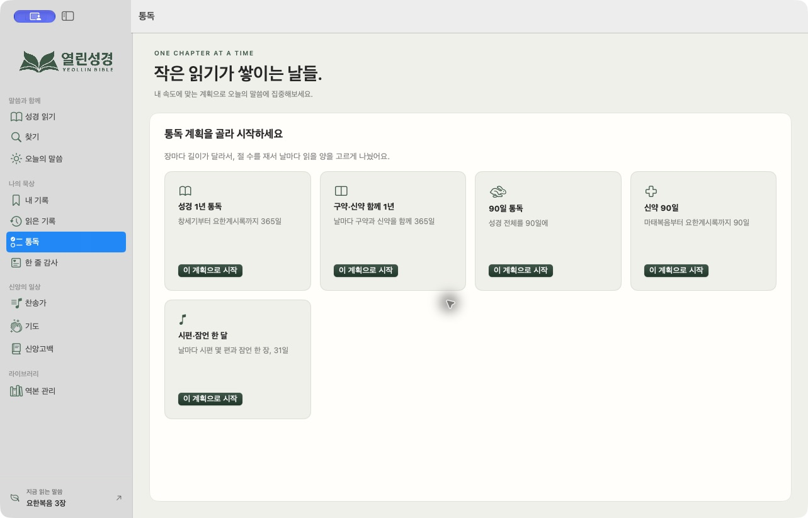
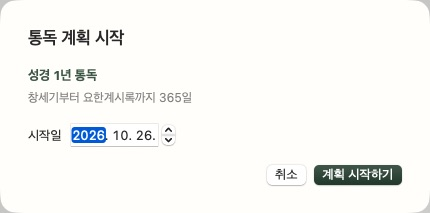
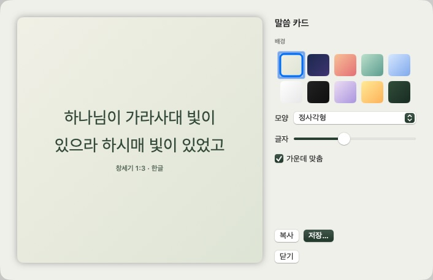
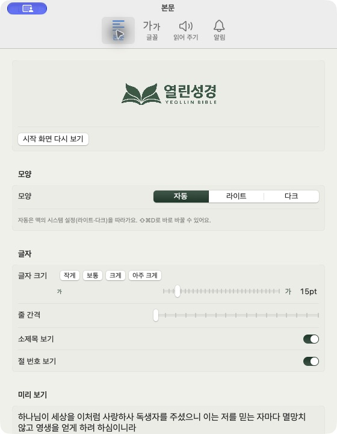

# 열린성경 1.4 · 전체 시안 적용 결과

승인된 독립 HTML 시안을 SwiftUI 앱에 적용했습니다. 실제 기록·본문·검색·통독·가져오기 기능을 유지하며, 시안용 데이터나 모의 저장 코드는 앱에 넣지 않았습니다.

## 적용

- 사이드바를 말씀·묵상·신앙의 일상·라이브러리로 묶고 실제 브랜드 로고를 표시합니다.
- 내 기록·읽은 기록·통독·감사·찬송가·기도·신앙고백·역본 관리에 공통 제목·설명·종이색 패널·여백을 적용합니다. 넓은 모니터에서는 패널을 1100pt로 제한합니다.
- 기존 읽기·찾기·오늘의 말씀 디자인과 기존 사용자 글꼴·크기·테마 설정을 이어갑니다.
- 앱 아이콘 ICNS와 로고, 라이트·다크 시작 배경을 Resources에 포함합니다. 시작 화면은 첫 실행에 보이며 인위적인 대기 시간 없이 시작할 수 있고 앱 메뉴·설정에서 다시 엽니다.
- 통독은 계획과 시작일을 확인한 뒤 저장합니다. 기존 통독 기록을 QA 목적으로 만들거나 삭제하지 않았습니다.
- 말씀 카드 기본 배경을 세이지 계열로 바꾸고 배경마다 접근성 이름을 붙였습니다.
- build.sh와 make_pkg.sh가 실제 이미지 리소스를 앱 묶음에 복사합니다. build.sh --no-open은 자동 실행 없이 빌드·갱신·서명을 마칩니다.

## 검증

- Swift 디버그·릴리스 빌드 성공.
- 기존 단위 테스트 5개 통과. 이 PC의 Swift 6.4 Command Line Tools에서 기본 테스트 빌드가 TestingMacros 로딩 오류를 냈으며, 아래처럼 설치된 공식 플러그인을 명시해 최종 통과를 확인했습니다.

```sh
swift test --scratch-path ~/Library/Caches/YeollinBible-ui-v2 \
  -Xswiftc -load-plugin-library \
  -Xswiftc /Library/Developer/CommandLineTools/usr/lib/swift/host/plugins/testing/libTestingMacros.dylib
```

- 실제 앱에서 기록·읽은 기록·통독·감사·찬송가·기도·신앙고백·역본 관리의 화면 전환과 공통 제목 표시 확인.
- 공개 한글 역본의 ‘빛’ 검색 219건, 첫 결과에서 창세기 1장 본문으로 이동 확인.
- 실제 말씀 카드 열기 및 세이지 배경 확인.
- 통독 시작일 확인 시트 열기·취소 확인.
- 설정의 로고·본문·자동/다크 모양 확인, 앱 메뉴의 시작 화면 다시 열기 및 읽기 복귀 확인.
- 실제 라이트·다크 시작 화면과 읽기 화면 캡처. 자료에 개인 노트·기도·가져온 역본 본문은 포함하지 않았습니다.
- 1.4 PKG 생성 및 사용자 Applications 앱의 코드 서명 검증 성공.

실행·검증한 새 앱은 `~/Applications/YeollinBible.app`입니다. `/Applications`의 기존 설치본을 갱신하려면 `dist/YeollinBible-1.4.pkg`를 설치하면 됩니다. 이번에는 권한이 필요한 시스템 설치 경로를 덮어쓰지 않았습니다.

## 실제 화면









